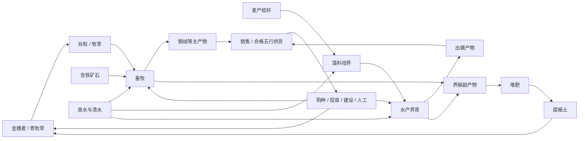

# Phase 7 — Demo V2养殖与资源循环

> 日期：2026-10-11。状态：**P7.a操作入口与数据底座已完成；P7.b～f均已逐阶段问答后起草，尚未实施或验收。下一步实施P7.b。默认入口仍V1，V2开发入口`play.bat v2`；完整验收后默认切V2，见[P7.f](phase-07f-试玩验收与V2交付.md)。**
> 用户已确认：钢绵羊＋滤藻鲤，仅购买幼体，不做繁殖/死亡/疾病/寿命；圈舍和水场2×2、同种最多4只且幼体计数；设施使用动物/基础食物/特殊食物三个配置栏位。地图下方新增20×8水库，V2基础地图20×22；付费扩张后置；存档无需兼容或迁移旧版本。
> 基线：[总规划](master-plan.md)、[Demo V1](demo-v1-plan.md)、[V1资源表](demo-v1-resources.md)、[Phase 6.5关闭记录](phase-06.5-UI美化与交互完善.md)。长期参考：[生产经营纲要](design-outline.md)、[物种候选库](production-system.md)、[经营机制补充](economy-systems.md)。
> 本文是产品V2的Phase文档；候选库的“v2”是资料修订号，不代表其中43种生物全部进入本阶段。范围决议见§8；标为建议的实现细节和数值仍需在资源关系表批次验证，不视为已完成。

## 1. 阶段目标和边界

V1已完成种植、天然资源点、加工、五行供货和普通雇工；Phase 6.5已完成明亮界面与基础交互。V2在此基础上接入畜牧、水产，让植物产物成为饲料，让养殖副产物返回种植和加工，并继续通过销售、供货获得元石。

本阶段的重点是**生产方式的差异与资源回流**。畜牧表现为养育、维持、周期采集；水产表现为水体经营、养育和出塘。养殖独立管理生命周期，不把动物塞进作物阶段图或现有加工批次里。

### 已确认的新决定

- 首批畜牧、水产各至少一条完整路线，与种植、加工、交易及供货相连。
- 缺食物或水只暂停对应生长和生产；不清空已积累进度，补齐后恢复。
- 采用钢绵羊＋滤藻鲤，配套青牧草和藻料培养；不同时加入备选物种。
- 只允许购买幼体，不加入繁殖、死亡、疾病和寿命。繁殖待寿命等机制设计后另排，不在V2后半补做。
- 新增圈舍与池塘（水场），各占2×2；每设施同种最多4只，幼体与成体共同计入容量。
- 点击设施后配置三个栏位：养殖动物、基础食物、特殊食物。食谱持续保留，维护由玩家手动或雇工整体执行，从共享仓库扣料。
- 基础食物负责维持与正常成长，特殊食物用于成体产出资源。本阶段不模拟饿死，“维持”体现为缺料暂停、补齐恢复。
- 在当前20×14陆地区域下方接入20×8水库，基础地图改为20×22。水场只能建在水库上；水产先做一个水体状态指标。
- 货币购买地图扩张只保留设计，推迟排期；开发阶段不要求兼容旧存档，不实现迁移。
- 三栏初值自动选择合法默认项，但必须提示具体结果；不自动购入或投喂。切换基础食谱保留当天实际服务记录，混龄采用幼体/成体汇总及最多4个个体展开。
- 缺饲料仍允许购买幼体，界面提示完整服务覆盖与剩余育成投入。增加各资源每日净增长一览，净负值单独分组，平衡归增长；后续玩家勾选关注材料在主界面展示。
- 特殊食物栏允许“暂不生产”，只停新周期，已有周期继续；默认仍有提示地选择合法食谱，不自动扣料。
- 养殖通过专属设施负责人实现，一人最多一座、一座最多一人，不参与其他农务/资源点；不增加工种或设施优先级。V2放开原2人雇佣上限，沿用成功一次1元石、无固定日薪，具体规则见P7.d。
- 增加可定位的养殖总览；资源关注清单初始为空，说明用途并提供选择入口，按所属槽保存。
- 最终采用两个独立新档各45天无注入验收：先手动后托管、额外早售粮后尽早托管；整体验收后默认`play.bat`/F5切V2，保留V1/V0显式入口。

### 沿用的经营基线

- 元石、五行材料属性与食材资格分离，不采用相生相克；蛊虫本体、战斗和饱食度留上游。
- 俯视点击，无玩家人物、雇工人物或搬运寻路；共享计数库存，资源直接进出仓库。
- 每天24AP、每时节15天；手动成功操作消耗AP，雇工按成功工作量收费。
- 日结束自动保存、三个槽、失败后阻断与原样重试；首次45天回顾，之后可以继续经营。
- 固定市场价格；订单按必要数量交付、只结算一次；rank1～5和静态供养值继续作为外部供货契约。
- 2560×1440主规格、明亮柔和UI、小图标与悬停说明，兼容窗口和独立UI缩放。

### 当前实施范围

| 内容 | 范围及详细设计状态 |
|---|---|
| 畜牧 | 钢绵羊、2×2圈舍，跑通幼体购入、育成、基础/特殊食物与周期采集 |
| 水产 | 滤藻鲤、2×2水场，建在新增水库上，跑通投苗、养育和出塘 |
| 支撑生产 | 一种饲料作物、一条藻料培养路线及必要矿物补料；具体名单见§2 |
| 回收 | 新增粪肥/鱼粪对应的堆肥变体，产出已有腐殖土 |
| 生命周期 | 幼体、成体、缺料暂停、采集/出塘；幼体仅采购，不做繁殖、死亡或寿命 |
| 人力 | 复用普通雇工名册，一人专责一座养殖设施，不兼职；V2取消固定人数上限，成功才计费 |
| 地图 | 20×22基础地图：上方20×14陆地＋下方20×8水库；付费扩张后置 |
| 存档 | 延续三槽与日自动保存；不要求旧版本兼容，不实现存档迁移或导入 |
| 美术 | 首先用可辨识示意图跑通流程；正式动物、圈舍和池塘图另列美术批次 |

繁殖、寿命、疾病、死亡、付费地图扩张、榨油、集热、岩石生物产业、多物种混养、动态气候、温度/溶氧/盐度模拟、物流容量、腐败、品质、遗传、特殊单位和战斗均不纳入首批。凡后续加入，需补充资源去向、成本与验收任务。

## 2. 首批生产路线

以下首批名单已由用户确认；具体食谱、配方、周期和价格已在[P7.a](phase-07a-操作入口与资源配数.md)配置并审计，养殖运行仍待P7.b/c，不把完整候选库转成实施清单。

| 定位 | 首批内容 | 必要投入 | 产物与回流 | 选择理由 |
|---|---|---|---|---|
| 畜牧 | 钢绵羊 | 草料/谷粒、清水；钢绒另需对应含铁补料 | 钢绒→销售/金供货；粪肥→堆肥→腐殖土→种植 | 同时验证周期采集和特殊原料限制 |
| 水产 | 滤藻鲤 | 基础藻料、特殊谷粒及可用水体 | 出塘鱼肉→销售/木供货；鱼粪→堆肥→腐殖土 | 验证水体经营和消耗成体的收获方式 |
| 饲料作物 | 青牧草 | 草籽及已有种植养护投入 | 牧草→畜牧，余料→堆肥/销售 | 农业承担持续饲料需求 |
| 水产基础培养 | 藻料培养设施 | 清水、明确的营养投入、固定光照与时间 | 藻料→水产 | 藻类属于水产基础培养，不新增第五种作物行为类别 |

堆肥鼠、净泥鳅等保留在长期候选库，未纳入首批。P7.a已明确钢绵羊直接使用含铁矿石，藻料每批清水3＋秸秆2→藻料6，不采用腐殖土营养投入；不能把普通岩石默认当含铁材料。每种动物都有明确的基础/特殊食物选项，运行条件在P7.b/c接入。

这是生产关系示意图，实际ID、数量、周期、价格、供养资格与成本分摊以P7.a及当前V2生产配置为准。静态配方完成不代表动物生命周期已运行。每项新增物品至少有消费者或销售用途；不为了列副产物而加入无人使用的材料。

动物的食性由具体饲料清单/配方决定，不能套用“同五行才能喂养”的蛊虫规则。动物可吃的材料也不自动成为蛊虫食材。

## 3. 先处理玩家主动操作入口

用户指出玩家主动消耗AP的入口不清楚。P7.a前，底部工具栏只创建雇工待办，手动农务在地格长侧栏下方；P7.a现已将V2工具栏改为默认手动单目标/委托框选切换，并前移手动操作行。成功手动农务仍扣1AP，资源采集、建设、加工启动/领取及拆除也可主动消耗AP。V0高级3×3工具不因本次入口改造自动接入V2。

### 已接受的操作方向

- 工具栏明确区分“手动操作”和“委托雇工”两种执行方式，当前方式常驻可见；图标保持小尺寸，执行方式与成本使用文字。
- 手动模式选择动作后点击目标立即执行，预览显示AP、材料和失败原因；初批按单目标实现，不把雇工框选变成免费手动批量操作。
- 委托模式继续框选任务、调整优先级、设置负责区域；说明“日结执行，成功收费，不消耗玩家AP”。
- 侧栏中的当前主动作前移到状态附近；完整种植资料仍可滚动查看。点一次成熟采收不需要反复确认，清理仍确认。
- 资源点、圈舍和池塘的手动操作与雇工指派分开显示，玩家能看出“立即执行”和“交给谁做”。
- 保留连续工具、右键查看、Esc层级、模态/输入阻断和存档失败保护。

同一种行为最终调用同一模型校验；只读预览不得扣AP、扣材料、创建任务或过日。手动失败零改动；委托只新增待办，不立即扣工资。手动与雇工均不能重复采同一株、收同一批或重复投喂同一日。

本阶段维持已实现的手动单目标；高级批量工具另排设计，不作为P7.b～f前置，也不新增免费批量能力。

## 4. 养殖模型与结算建议

### 4.1 占地与在养记录

圈舍和池塘（水场）均为2×2占地设施。圈舍建在有效陆地，水场的全部四格必须在水库内；禁止越界、跨岸、覆盖植物、资源点或其他设施。

新增水库接在原陆地下面，零起始坐标区域为`[0,14,20,8]`，即y=14..21；整个V2基础地图为20×22，原陆地与资源点布局保留。V1现有土地/设施校验默认要求可耕地，不能直接用于水场：需把“可开垦”和“某类设施可建”分开校验，禁止通过将水域标为可耕来绕过限制。相机全图、边界、框选、地图数据和快照校验均按新尺寸处理。

每设施只养一种动物，容量4只，幼体与成体均计入；成长不会释放空位，也不会另生成一只成体。空位不足时整次购入失败，不扣款、不部分塞入。水库作为本版基础地图的一部分，不通过本阶段未实现的付费扩张购买。

小规模记录每个个体的唯一ID、物种、所属设施、幼体/成体状态、成长进度和生产进度；面板按设施汇总展示，不模拟移动实体。生物不是可随意增减的普通材料堆叠，活体记录与可堆叠产物分开校验。

买入幼体须同时检查元石、设施类型、已选物种和剩余容量；失败不扣款、不生成个体。出塘或处置必须更新同一份个体记录，禁止既在设施中存活又计入售出/收获。首批建议不开放自由转移；非空设施不能直接拆除或直接切换物种。不做繁殖计划、繁殖按钮和免费幼体生成。

### 4.2 三栏配置与整体维护

点击设施后的三个配置栏位固定为：

1. **养殖动物**：选择该设施可养的物种，显示在养数量/4、幼体/成体和购买幼体数量；购入操作另显示完整总价。
2. **基础食物**：选择该物种可用的基础食谱，维持并支持幼体正常成长；显示每次整体维护所需材料与持有数量。
3. **特殊食物**：选择成体生产食谱或“暂不生产”，显示投入、周期与主副产物；幼体不提前消耗成体生产料。停产选择保留，已有周期按实际投入继续，详情见[P7.c](phase-07c-特殊生产与养殖回流.md)。

状态、成长进度、水体指标以及维护/采集按钮位于这三个栏位旁或下方，不增加第四个养殖配置栏位。食谱选择属于持续计划，仅改变配置，不购买、不扣料、不扣AP、不推进成长；无效食谱拒绝，物种切换时校验兼容性，不能沿用不适配的旧食谱。

基础料与特殊料分别满足不同需求。缺基础料/有效水条件暂停成长或运行周期；缺新一轮特殊料只阻止启动新周期，已投周期不重复检查特殊料库存。主副产物随有效周期收取，不能以“普通基础食物已喂”跳过特殊投入。

整体维护由玩家手动或指派雇工执行；仅选择食谱不会执行维护。每次显示本设施内适用个体的完整需求，基础维持按全部在养个体计算，特殊生产料按适用成体计算；避免四格设施变成四份任务，或对幼体扣四份成体生产料。基础维护与特殊生产服务分别记录完成状态，缺料的分支失败零改动，不能扣完基础料后再把整次操作显示为完全失败。

### 4.3 基础维持与特殊生产

- 基础食物按实际服务日记录，每有效日成长100；羊目标600、鱼400。缺料/水时暂停不清进度，刚成年下一服务日才可启动特殊周期。
- 特殊产物必须有对应特殊原料。钢绵羊没有含铁补料时可以维持与成长，但不能凭空产出钢绒。
- 基础只服务当日尚未喂过的个体，原玩家/雇工食谱与投入保存；特殊只投已成年、空闲且当日基础有效的对象，启动一次扣料。两分支各自整场原子执行，至少一项有效时合计手动1AP或人工成功工作1次；无新工作0费用。
- 钢绵羊每周期含铁矿石1、3个有效日→钢绒1＋羊粪肥1；滤藻鲤每周期谷粒1、2个有效日→鱼肉3＋鱼粪1，均按个体计。羊剪毛保留，鱼出塘移除；待收未领不入库。
- 已满成长/生产进度不会因多点按钮额外增加产量；零在养对象不构成成功工作，不扣AP或工资。

水场只记录水体可用度，初值/上限100，在养日结−5，衰减后≤30暂停；空场不衰减、不因再投苗重置。手动水维护清水2＋1AP恢复40，投喂先预检日结水条件；负责人阈值≤60时尝试一次自动修水，见P7.d。水库不生成可交易清水，不引入温度、溶氧、盐度。P7.a已配置这些初值，运行接入待P7.b/d。

### 4.4 采集与出塘

- 钢绵羊成体保留，达到周期后剪毛；收取一次重置相应生产进度，不能同时拿未到期下一轮产物。
- 鱼肉出塘会移除对应成体；出塘后该个体不能继续生产或被再次出售为活体。
- 粪肥/鱼粪与基础维持、周期生产的关联必须写入配方。没有有效投入的暂停日不免费生成副产物。
- 待收数量、产物来源与收取记录需持久化；等待玩家收取不等于每日再次生成同一份产物。

P7.c使用唯一周期权益，按设施一次收取全部待收个体；清退放弃在养/在制/待收，1AP且不退款、不产物。羊粪肥2或鱼粪2→腐殖土2、2日，领取后实际施肥验证回流。

### 4.5 繁殖与寿命后置

用户明确本阶段不做繁殖，因为寿命尚未设计。幼体只能采购，正常成长为原个体的成体；不加入亲本、卵、繁殖进度、自动增殖或衰老/死亡逻辑。数据配置留出将来扩展的职责边界即可，不要求提前实现无用途字段和隐藏按钮。

### 4.6 日结顺序与保存

现有V1顺序为雇工工作→作物与环境→资源点额度刷新→加工完成→订单推进→日报/回顾→自动保存。V2须用统一调度扩展，不能让每个面板各自推进一天。

顺序按P7.b/c/d设计：雇工→水体衰减/暂停判定→养殖成长/周期→作物与环境→资源额度刷新→加工就绪→订单→日报/资源账封账→同一快照自动保存。服务日D统一传入，日变更回调n结算D=n−1。刚成年、刚就绪下一服务日才可服务/收取；加工和养殖待收未领不入库存，副产物也随实际收取产生。

日结产生的库存、元石、个体、设施、三栏配置、维护状态、水体、雇工费用、订单和统计作为一份完整快照保存。写失败时阻断后续操作；重试只保存原样结果，不重新喂养、产出或收费。打开面板、重载、现实等待和UI缩放不推进养殖。

用户允许开发阶段不兼容旧存档，无需迁移。本阶段不要求V0/V1快照转换、向旧schema反写或旧档导入；三槽与覆盖确认仍保留。不支持的档案明确提示重新开档，不静默解释为新版数据或自动覆盖。P7.a现行产品`farm_demo_v2`、目录`user://farm_demo_v2_slots`、schema7；P7.b建议升8，后续实际schema按契约变化定稿回写，不把草稿字段当已支持。

## 5. 人工、经济与统计接入

### 普通雇工

按[P7.d](phase-07d-设施负责人.md)，通过指派专属负责人照料圈舍/水场：每人最多一设施、每设施最多一人，不做其他农务/资源点，不增加职业、养殖偏好或设施优先级。巡栏固定为收取→必要修水→整体维护；原多工种建议撤回，P7.a早稿相应条款已同步。

V2取消原2人固定上限，普通雇工与负责人共用名册。沿用招聘免费、无固定日薪、成功一次1元石、每人日预算默认12/工作最多12次；空场/暂停/无需服务不收费。指派0AP、不立即工作，改派明确解除旧安排，保留全球农务标记和选种；解除不自动恢复旧农务范围。

共享库存/现金按员工UID轮流重查，专责候选只含本设施步骤。已手动服务不重复扣料，部分步骤成功后预算不足报告真实未完成项；全鱼先出塘后不为已空场修水/喂料。原开局仅余8元石不足10次育成维护，P7.f分别验证手动启动和额外早售粮后托管；不收满日薪或免费补钱。建造拆除、补苗、采购与加工启动仍手动。

### 经济与供货

- 新资源沿用五行、独立供养资格、固定价格与静态供养值。至少验证一种养殖产物能加入对应订单，不能只在仓库累积。
- 养殖单位标准成本包含饲料、水、特殊原料、标准工作量与时间；主副产物分摊整批成本，不能每个产物各背一次全成本。
- 生物购入和设施建设作为一次性发展支出记录，首版建议不在每轮产物成本中重复扣整笔购入价；该成本口径须在资源表明确。
- 回流图可以有循环，基准成本图必须可求值；腐殖土继续有明确基准来源，不能由“喂养→粪肥→饲料”互相引用递归定义价格。
- 幼体开放采购，食物和补料是否开放采购按物品明确配置；采购再出售/供货不得套利，也不能在购入、收获或退款时重复生成价值。
- 首批不因新增材料自动提高V1营业收入开放rank的门槛或改变全部旧售价；需要调平衡时单独记录依据。

### 报告与回顾

最近15日报增加养殖投放/育成、维持、暂停原因、剪毛/出塘和副产物条目，仍采用分条报告。时节小结与首次45天回顾增加对应数量、基础/特殊食物及水投入、生物购入支出和期末幼体/成体数量；不把进料、成熟和收取重复算作三份出售收入。

库存、在养个体和未收产物分开显示。回顾仍以实际元石收支为准，不把剩余生物和材料估值冒充现金利润；首轮冻结和继续经营规则保持。

[P7.e](phase-07e-经营总览与资源关注.md)增加养殖总览与定位，区分今日待负责人执行和日结实际停产。日报保留15日、三个时节累计另存，首45天期末动物/待收/在制摘要冻结；采购/人工养殖明细是已有总额子项，不重复加支出。

### 资源一览（新增）

用户确认显示各资源每日净增长：净值≥0归“增长与平衡”，净值<0归“负增长”，后续可勾选材料显示在主界面。[P7.b §7](phase-07b-养殖基础与成长.md#7-资源一览设计建议)建议默认显示当日实际入库、出库及净变化，周期材料只在收取入库日计实际增长；最近7个已结算日均值另作趋势视图，待收和在制不计库存。采购/出售/订单也纳入库存收支并区分来源，元石单列现金账。

P7.b建立完整资源账和基础一览，P7.c/d接后续产物/工作原因，P7.e接关注条。每新槽关注初始为空，主界面显示用途及“选择关注资源”入口；勾选稳定ID和顺序，按槽在日结保存，可见项放不下时收进更多，不截断清单。历史账继续滚动，不随首次45天回顾冻结。

## 6. 分批实施

P7.a已完成，P7.b～f均遵守**每个小阶段起草前先提问**并已分别起草；按用户要求，在全部问答结束后本轮统一同步规划/交接。下一步按顺序实施P7.b。代码、测试、配置/素材和文档按类型分批提交，设计状态不能替代实施验收。

| 批次 | 工作 | 完成条件 |
|---|---|---|
| P7.a 操作与配数（完成） | 修正手动AP入口；按已确认范围补资源总表、食谱、20×22地图布局和独立schema7存档。设计稿：[phase-07a-操作入口与资源配数](phase-07a-操作入口与资源配数.md)，[验收记录](phase-07a-验收记录.md) | 已通过操作/数据/地图/存档及无注入种植建设台账；养殖收益按后续批次回放 |
| P7.b 养殖基础与成长（设计稿已起草） | 复用已建水库/设施；三栏自动选择提示、容量4、幼体购入、实际服务记录、成长/水体/暂停恢复与持久化；建议增加资源账和基础一览。设计稿：[phase-07b](phase-07b-养殖基础与成长.md) | 两种幼体可育成，原服务不被食谱切换覆盖，缺料风险及实际收支可观察；失败零改动、读档不重复结算 |
| [P7.c 特殊生产与回流](phase-07c-特殊生产与养殖回流.md)（设计稿） | 暂不生产、唯一周期权益、特殊投料、剪毛/出塘、副产物实际回流 | 两种产物可实际领取/供货；粪肥堆肥后用于种植；读档/重复操作不多领 |
| [P7.d 设施负责人](phase-07d-设施负责人.md)（设计稿） | 专责一设施不兼职、开放人数、固定巡栏、计件费用与现金路线 | 手动/负责人不重复服务，失败不收费、无固定日薪，人数与独占引用正确 |
| [P7.e 经营总览与资源关注](phase-07e-经营总览与资源关注.md)（设计稿） | 可定位总览、三栏详情、初始空关注条、条目报告与冻结回顾 | 鼠标能完成全流程，实际收支可观察、关注按槽保存，信息与模型一致，无输入穿透 |
| [P7.f 试玩验收与V2交付](phase-07f-试玩验收与V2交付.md)（设计稿） | 双路线各45日无注入、回归/截图、Windows包、说明与验收后默认切换 | 两路线回流/供货/再投资均通过；完整包可运行，默认V2与旧显式入口正确 |

开发期`play.bat v2`独立，默认`play.bat`/F5继续已验收V1；用户已确认完整验收后默认切V2并保留V1/V0显式入口。复用土地、时钟、库存、经济与UI底座，养殖作为独立状态模块接入，无需复制全部V1模型和整套界面。

## 7. 验收清单

- [ ] 正式新游戏可以在没有开发注入材料的情况下启动畜牧和水产两条路线。
- [ ] 同一个工具的手动/委托含义、AP或工资成本清楚，玩家主动操作入口无需在长侧栏中寻找。
- [ ] 幼体成长、缺食/缺水暂停、补齐恢复和成体生产均可见，缺料不导致死亡或已积累进度丢失。
- [ ] 2×2圈舍/水场占用与容量4正确，幼体计数；20×8水库及20×22边界正确，跨岸/越界/满容量等失败零改动。
- [ ] 特殊产物消耗对应特殊原料；副产物可以实际回到堆肥与农业，暂停日不凭空产料。
- [ ] 周期采集与出塘差异正确，同一个体/产物/投喂工作不能重复结算。
- [ ] 三栏配置可用，选择配置不扣料/扣AP/推进时间，食谱持久化；仅采购生成幼体，幼体成长不增加个体数，不存在繁殖入口。
- [ ] 自动三栏默认项有提示；混龄记录可展开，切餐保留原服务；缺饲料采购显示完整服务覆盖与育成风险。
- [ ] 资源一览实际收支守恒、净负值及平衡分组正确；周期产物未领取不算增长，历史均值与实际日账分开；主界面可显示玩家关注材料。
- [ ] 关注初始为空且用途/选择入口可见，取消最后一项重新显示；关注按所属槽在日结保存，屏幕更多不截断清单。
- [ ] 手动与雇工共享校验；成功才收费，失败不收费、不自动采购，不消耗玩家AP执行雇工工作。
- [ ] 一人一养殖设施不兼职，V2开放2人以上，无工种/设施优先级；收取→必要修水→整体维护、预算/现金与实际工作量正确。
- [ ] 新资源用途、成本分摊、供养资格、rank1/3/5订单和采购防套利检查通过。
- [ ] 每日自动保存与失败原样重试覆盖动物、三栏配置、维护、水场、产物和费用；不支持的旧档明确提示重新开档。
- [ ] 首次45天包含养殖收入、投入、期末个体与回流记录，之后继续经营不改写首轮回顾。
- [ ] 两个正式新档各45日无注入完成手动后托管/早售粮早托管、五行供货与再投资；满容量持续供料及人工现金有逐日证据。
- [ ] V1/V0及历史场景按受影响范围回归；新版与旧版入口明确，发行包实际运行通过。
- [ ] 主规格及兼容窗口/三档UI缩放截图可读；圈舍、池塘、手动/委托和阻塞原因可辨识。
- [ ] 独立V2包、完整冒烟/解压运行通过后默认`play.bat`/F5切V2，旧产品显式入口与存档隔离保留。

具体测试命令、数据烘焙入口、快照版本和发行文件名在实现批次建立后回写，不在草案中把不存在的脚本列为已可用入口。场景图沿用后续美术的机位、光照、拼接与比例审核要求，示意图验收不代表完整正式美术交付。

## 8. 范围决议与下一批设计

| 项目 | 已确认决定 |
|---|---|
| 首批物种 | 钢绵羊＋滤藻鲤，配青牧草与藻料培养，各一条路线 |
| 生命周期 | 仅采购幼体；繁殖等待寿命等设计，当前不做死亡/疾病/寿命 |
| 设施 | 圈舍和池塘（水场）均2×2；每设施同种最多4只，幼体也计数 |
| 配置 | 动物、基础食物、特殊食物三个栏位；基础料支持成长，特殊料支持成体生产 |
| 特殊计划 | 允许暂不生产，仅停新周期，已有投入/待收不被抹除；选择自身不扣料 |
| 维护 | 食谱持续保留，玩家手动或雇工整体维护，直接取共享库存 |
| 负责人 | 专责一设施、不做其他农务，固定巡栏/成功计件，无职业与设施优先级；V2取消固定雇佣人数上限 |
| P7.b交互 | 默认三栏需提示；基础切餐保留已喂记录；混龄汇总可展开；缺料可购买并显示投入风险 |
| 资源一览 | 各资源实际净增长与历史均值分开，增长/负增长分组、平衡归增长；关注初始为空、有用途提示、按槽保存，见P7.b/e |
| 总览/记录 | 可定位养殖总览、条目日报与时节累计；首45天期末摘要冻结，当前资源账继续 |
| 水域 | 原20×14地图下接20×8水库，基础地图20×22；水场必须建在水库上；一个水体指标 |
| 主动操作 | 接受工具栏手动/委托切换；初批手动单目标，手动批量升级仍单独确定 |
| 地图扩张 | 保留货币购买扩张的方向，推迟排期，不实现本阶段购买/解锁 |
| 存档 | 开发阶段允许旧档不兼容，无需迁移；保留三槽与自动保存规则 |
| 最终验收/入口 | 两条独立45日无注入路线；全部验收通过后默认V2，显式V1/V0保留 |

付费扩张的后续设计方向为用元石解锁新增土地/水域，并统一校验可建范围、占用与存档。此次只登记方向，不增加购买入口、锁格规则、扩张价格或无用途存档字段；当前20×22是完整基础地图。

P7.a已补齐食谱、价格、周期、造价、水体规则、主副产物与静态供养值，并完成10日无注入启动台账。P7.b～f均已问答和起草；下一步依[P7.b设计稿](phase-07b-养殖基础与成长.md)接入真实幼体、服务/成长、水体与资源账，再按c～f顺序推进。初始60元石和原赠送种子不变，四只持续供料及双路线45日闭环仍待验证，付费扩张不参与。

范围已确认的内容不重复询问。实现中若数值显示现有泉水额度、初始现金或生产原料无法支撑四只容量下的基本养育，先给出具体瓶颈与调整提案，不以免费补料或删去特殊投入掩盖问题。

## 9. 执行记录

### 2026-10-11：Phase 7 / V2起草

- 用户要求先起草Phase文档；本批只整理设计，养殖代码尚未实施。
- 已阅读V1/Phase 6.5关闭记录、资源关系表、生产纲要、物种候选库及机制补充，并核对现有手动AP入口、土地占用、日结与schema 6快照。
- 用户确认畜牧和水产各一条路线；缺食物或水暂停并可恢复；不引入死亡、疾病和寿命。上述决定替代长期候选中对应的复杂生命周期设想。
- 建立路线候选、P7.a～f、验收清单和六项待确认问题；同步总规划及交接入口。所有实现与验收仍未勾选，当前默认入口及代码未改变。

### 2026-10-11：范围问答与设施/水库确认

- 用户接受钢绵羊＋滤藻鲤和手动/委托方向；明确只采购幼体，繁殖因寿命未设计而后置。
- 用户确定2×2圈舍/水场、动物/基础食物/特殊食物三栏、整体维护和单水体指标；水场建设必须位于水库。
- 补充确认水库接在现有地图下面，基础20×22、水域20×8；每设施同种最多4只且幼体计数；维护由玩家或雇工执行，配置食谱本身不执行维护。
- 货币购买地图扩张保留设计但推迟排期；开发阶段无需旧档兼容或迁移。已移除繁殖实现/验收任务，更新P7.a～f；代码尚未实施，下一批补资源关系与配数。

### 2026-10-11：P7.a 设计稿起草

- 按用户要求先出设计稿再实施。已核对V1资源表/订单与成本审计机制、物种候选库、schema 6快照、工具栏与侧栏现状、farm_01地图与烘焙管线。
- 产出[phase-07a设计稿](phase-07a-操作入口与资源配数.md)：手动/委托工具栏方案、7新物品＋2活体、青牧草、圈舍/水场/藻类培养槽、4新配方、两物种完整配数（成长/周期/食谱/水体指标）、farm_02 20×22布局、schema 7存档方案、成本模型与防套利、60元石启动演算。
- 稿内列出8项待确认决策（补料形态、藻料营养源、鲤鱼特殊食物、粪肥堆肥产出、补料消耗时点、默认模式、幼体价格、V2命名）；确认后按稿内§9任务清单实施，代码仍未动。

### 2026-10-11：P7.a操作入口与数据底座完成

- 新增V2产品数据25物品/5植物/7设施/13配方，以及两物种后续养殖规则与固定4只成本参考；已烘焙和审计。原V1逻辑改为可传入数据源，V2复用种植/加工/经营/雇工/日结及界面底座。
- 实装默认手动单目标、委托框选、切换取消未提交操作而保留待办、成本/失败悬停和侧栏操作行；末AP日结保存与原雇工工资回归通过。
- 新增20×22地图与下方160格水域；水场全占地校验、读档与拆除恢复通过。V2独立schema7三槽、`play.bat v2`/`test-v2.bat`可用；默认入口仍V1。
- 无注入10日台账验证草籽/种植/采集/早售粮/建设路线，最终30元石可预留一羊两鱼采购22。动物运行、维护分支、四只容量持续供料和首次45日验收尚未通过，按P7.b～f继续。详见[P7.a验收记录](phase-07a-验收记录.md)。

### 2026-10-11：P7.b问答与资源一览设计

- 按用户“每阶段起草前先提问”完成P7.b问答，新增[P7.b设计稿](phase-07b-养殖基础与成长.md)，其余阶段未提前起草。
- 用户确认默认选择有提示、基础切餐保留已喂个体原服务、混龄汇总/展开、缺料可购入并显示参考投入；新增每日资源净增长与后续主界面勾选关注。
- 本稿建议实际日账仅计真实入/出库，周期产物在收取日入账；另看7日均值。P7.b接账和基础一览，后续接产物、工作与关注条。
- 修正P7.b重复建设水库及资源表待补的过期描述。此批只修改文档，当前代码仍schema7，P7.b养殖、资源账及拟议schema8均未实施。

### 2026-10-11：P7.b～f逐阶段设计完成并统一同步

- 按用户要求分别问答再起草c/d/e/f，全部确定后统一同步，保留此前记录的当时事实。
- 特殊栏加入暂不生产；人力改为一人一设施、不参与其他农务，撤回工种/偏好/设施优先级建议，V2开放固定人数上限。
- 补齐总览定位、初始空关注用途提示与按槽保存、实际收支和条目报告/三个时节累计/首45天冻结。
- 用户确认双路线各45日无注入与验收后默认V2，P7.f补全现金门槛、满容量供料、回流/供货/再投资、独立Windows包和旧入口回归。
- 本批仅文档；P7.a历史验收保持，代码仍schema7/雇佣上限2/默认V1。下一实施阶段P7.b，V2尚未关闭。
