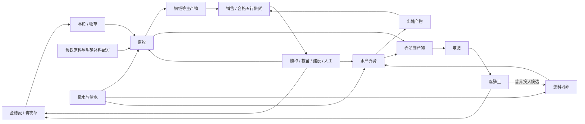

# Phase 7 — Demo V2养殖与资源循环

> 日期：2026-10-11。状态：**首版草案，尚未开始代码实施。**
> 用户已确认：畜牧和水产各跑通一条生产路线；缺食物或水时暂停生长与生产，补齐后恢复；暂不加入死亡、疾病和寿命。
> 基线：[总规划](master-plan.md)、[Demo V1](demo-v1-plan.md)、[V1资源表](demo-v1-resources.md)、[Phase 6.5关闭记录](phase-06.5-UI美化与交互完善.md)。长期参考：[生产经营纲要](design-outline.md)、[物种候选库](production-system.md)、[经营机制补充](economy-systems.md)。
> 本文是产品V2的Phase文档；候选库的“v2”是资料修订号，不代表其中43种生物全部进入本阶段。除明确注明用户确认的内容外，以下为起草建议，数值与剩余决策在§8冻结。

## 1. 阶段目标和边界

V1已完成种植、天然资源点、加工、五行供货和普通雇工；Phase 6.5已完成明亮界面与基础交互。V2在此基础上接入畜牧、水产，让植物产物成为饲料，让养殖副产物返回种植和加工，并继续通过销售、供货获得元石。

本阶段的重点是**生产方式的差异与资源回流**。畜牧表现为养育、维持、周期采集；水产表现为水体经营、养育和出塘。养殖独立管理生命周期，不把动物塞进作物阶段图或现有加工批次里。

### 已确认的新决定

- 首批畜牧、水产各至少一条完整路线，与种植、加工、交易及供货相连。
- 缺食物或水只暂停对应生长和生产；不清空已积累进度，补齐后恢复。
- 暂不加入动物死亡、疾病和寿命。长期纲要中相关条目不作为本阶段验收要求。

### 沿用的经营基线

- 元石、五行材料属性与食材资格分离，不采用相生相克；蛊虫本体、战斗和饱食度留上游。
- 俯视点击，无玩家人物、雇工人物或搬运寻路；共享计数库存，资源直接进出仓库。
- 每天24AP、每时节15天；手动成功操作消耗AP，雇工按成功工作量收费。
- 日结束自动保存、三个槽、失败后阻断与原样重试；首次45天回顾，之后可以继续经营。
- 固定市场价格；订单按必要数量交付、只结算一次；rank1～5和静态供养值继续作为外部供货契约。
- 2560×1440主规格、明亮柔和UI、小图标与悬停说明，兼容窗口和独立UI缩放。

### 首版建议范围

| 内容 | 草案建议 |
|---|---|
| 畜牧 | 一种动物、一种圈舍，跑通购入幼体、育成、投喂和采集 |
| 水产 | 一种水生动物、一种养殖池，跑通投苗、养育和出塘 |
| 支撑生产 | 一种饲料作物、一条藻料培养路线及必要矿物补料；具体名单见§2 |
| 回收 | 新增粪肥/鱼粪对应的堆肥变体，产出已有腐殖土 |
| 生命周期 | 幼体、成体、缺料暂停、采集/出塘；建议本阶段后半加入有限容量下的简化繁殖 |
| 人力 | 复用普通雇工，新增养殖工作的偏好与按设施指派 |
| 地图 | 先在20×14内验证圈舍、池塘与原有生产布局；空间不足再决定扩容 |
| 存档 | 建议V2独立三槽，V1存档与试玩包保留；是否导入V1另行确认 |
| 美术 | 首先用可辨识示意图跑通流程；正式动物、圈舍和池塘图另列美术批次 |

榨油、集热、岩石生物产业、多物种混养、动态气候、温度/溶氧/盐度模拟、物流容量、腐败、品质、遗传、特殊单位和战斗不因进入V2自动纳入首批。凡后续加入，需补充资源去向、成本与验收任务。

## 2. 首批生产路线建议

以下物种为候选短名单，**尚未定稿**。不把完整候选库转成实施清单。

| 定位 | 建议主选 | 必要投入 | 产物与回流 | 选择理由 |
|---|---|---|---|---|
| 畜牧 | 钢绵羊 | 草料/谷粒、清水；钢绒另需对应含铁补料 | 钢绒→销售/金供货；粪肥→堆肥→腐殖土→种植 | 同时验证周期采集和特殊原料限制 |
| 水产 | 滤藻鲤 | 藻料、可用养殖水体 | 出塘鱼肉→销售/木供货；鱼粪→堆肥→腐殖土 | 验证水体经营和消耗成体的收获方式 |
| 饲料作物 | 青牧草 | 草籽及已有种植养护投入 | 牧草→畜牧，余料→堆肥/销售 | 农业承担持续饲料需求 |
| 水产基础培养 | 藻料培养设施 | 清水、明确的营养投入、固定光照与时间 | 藻料→水产 | 藻类属于水产基础培养，不新增第五种作物行为类别 |

钢绵羊的低复杂度备选是堆肥鼠；水产的废料处理备选是净泥鳅。备选用于调整首批定位，不默认与主选一起加入。钢绵羊的补料是否经独立配方制备、藻料营养投入是否复用腐殖土，须在资源表中明确；不能把普通岩石默认当含铁材料。

这是生产关系草图，不是已冻结配方。资源表需要逐项定义实际ID、输入数量、周期、主副产物、价格、用途、供养资格与成本分摊。每项新增物品至少有消费者或销售用途；不为了列副产物而加入无人使用的材料。

动物的食性由具体饲料清单/配方决定，不能套用“同五行才能喂养”的蛊虫规则。动物可吃的材料也不自动成为蛊虫食材。

## 3. 先处理玩家主动操作入口

本轮用户指出玩家主动消耗AP的入口不清楚。当前代码事实是：底部工具栏框选只创建雇工待办；手动农务在地格侧栏下方的图标行，成功一次扣1AP。V1资源采集、建设、加工启动/领取及拆除也可主动消耗AP。V0的高级3×3工具并未因此自动出现在V1。

### 推荐改法

- 工具栏明确区分“手动操作”和“委托雇工”两种执行方式，当前方式常驻可见；图标保持小尺寸，执行方式与成本使用文字。
- 手动模式选择动作后点击目标立即执行，预览显示AP、材料和失败原因；初批按单目标实现，不把雇工框选变成免费手动批量操作。
- 委托模式继续框选任务、调整优先级、设置负责区域；说明“日结执行，成功收费，不消耗玩家AP”。
- 侧栏中的当前主动作前移到状态附近；完整种植资料仍可滚动查看。点一次成熟采收不需要反复确认，清理仍确认。
- 资源点、圈舍和池塘的手动操作与雇工指派分开显示，玩家能看出“立即执行”和“交给谁做”。
- 保留连续工具、右键查看、Esc层级、模态/输入阻断和存档失败保护。

同一种行为最终调用同一模型校验；只读预览不得扣AP、扣材料、创建任务或过日。手动失败零改动；委托只新增待办，不立即扣工资。手动与雇工均不能重复采同一株、收同一批或重复投喂同一日。

手动批量工具是否在V2接入、是否沿用V0的购买升级与成功AP折半规则，是独立待确认项，不默认为新增免费能力。

## 4. 养殖模型与结算建议

### 4.1 占地与在养记录

圈舍和池塘是占地设施，使用现有土地冲突校验，禁止覆盖植物、资源点或其他设施。圈舍容量与地图占地分别配置；未满容量才可购入/投放幼体或接收繁殖结果。

首批建议一座设施只养一种物种。小规模记录每个个体的唯一ID、物种、所属设施、幼体/成体状态、成长进度和生产进度；面板按设施汇总展示，不模拟移动实体。生物不是可随意增减的普通材料堆叠，活体记录与可堆叠产物分开校验。

买入幼体须同时检查元石、设施类型和剩余容量；失败不扣款、不生成个体。繁殖、出塘、转移或处置必须更新同一份个体记录，禁止既在设施中存活又计入售出/收获。首批建议不开放自由转移；非空设施不能直接拆除。

### 4.2 基础维持与特殊生产

- 基础食物与水支持当天成长/生产；缺少时暂停，补齐后从原进度继续。
- 特殊产物必须有对应特殊原料。钢绵羊没有含铁补料时可以维持与成长，但不能凭空产出钢绒。
- 每项维持动作按设施内适用个体数计算完整投入；显示持有/需要与服务对象。投入、当日已完成标记与有效期共同保存，不能反复喂养同一天获得多次成长。
- 手动投喂建议每座设施一次成功工作扣1AP；从共享仓库取料，不引入携带、运输或额外仓储容量。投喂批量、补水频率、特殊补料的消耗时点在资源表批次定稿。
- 已满成长/生产进度不会因多点按钮额外增加产量；零在养对象不构成成功工作，不扣AP或工资。

首版水产建议配置一个简化“水体可用度”，投苗前需要有效水体，清水维护可以恢复可用度；过低暂停养育。它与日常饲料分开，不等于每天抽干并重灌整个池塘。用量、消耗频率及是否需要单独清洁动作待冻结；不引入溶氧、盐度和多个同时衰减的环境指标。

### 4.3 采集与出塘

- 钢绵羊成体保留，达到周期后剪毛；收取一次重置相应生产进度，不能同时拿未到期下一轮产物。
- 鱼肉出塘会移除对应成体；出塘后该个体不能继续生产、被出售为活体或参与繁殖。
- 粪肥/鱼粪与基础维持、周期生产的关联必须写入配方。没有有效投入的暂停日不免费生成副产物。
- 待收数量、产物来源与收取记录需持久化；等待玩家收取不等于每日再次生成同一份产物。

### 4.4 简化繁殖提案

建议V2后半加入可关闭的繁殖计划：同物种成体满足数量、营养、周期和空位条件，才产生幼体。首版不模拟性别、配对、基因或品质；具体亲本数量与繁殖成本在数值表定义。

默认不开启自动繁殖，面板显示空位、需要的投入和下一次进度。满容量暂停繁殖，不把幼体塞入材料库存，也不自动卖出。新生个体从下一游戏日开始成长与消耗，不在出生当天再次繁殖或生产。是否将繁殖列为本阶段必验内容，见§8。

### 4.5 日结顺序与保存

现有V1顺序为雇工工作→作物与环境→资源点额度刷新→加工完成→订单推进→日报/回顾→自动保存。V2须用统一调度扩展，不能让每个面板各自推进一天。

建议先让雇工完成当天投喂/维护，再结算养殖成长、周期、副产物与繁殖；培养/加工产物完成后进入待收，领取前不能当成共享库存。明确新购、刚成年、新生以及当天已手动服务对象的首次生效日，避免同日多算。

日结产生的库存、元石、个体、设施、水体、雇工费用、订单和统计作为一份完整快照保存。写失败时阻断后续操作；重试只保存原样结果，不重新喂养、繁殖、产出或收费。打开面板、重载、现实等待和UI缩放不推进养殖。

## 5. 人工、经济与统计接入

### 普通雇工

建议首批养殖工作为投喂、必要水体维护、剪毛/产物收取和出塘；是否合并投喂与补水由日常工作量决定。设施按ID独立指派，沿用个人偏好、优先级、日预算、暂停和成功工作上限。

同一设施的多格占地不能生成多份同类任务。工作在日结执行；缺料、缺钱、状态不符或已完成的任务跳过，失败不收费、不自动采购。建造拆除继续手动；是否允许雇工管理繁殖后续明确。

### 经济与供货

- 新资源沿用五行、独立供养资格、固定价格与静态供养值。至少验证一种养殖产物能加入对应订单，不能只在仓库累积。
- 养殖单位标准成本包含饲料、水、特殊原料、标准工作量与时间；主副产物分摊整批成本，不能每个产物各背一次全成本。
- 生物购入和设施建设作为一次性发展支出记录，首版建议不在每轮产物成本中重复扣整笔购入价；该成本口径须在资源表明确。
- 回流图可以有循环，基准成本图必须可求值；腐殖土继续有明确基准来源，不能由“喂养→粪肥→饲料”互相引用递归定义价格。
- 活体、饲料和补料是否开放采购按物品明确配置；采购再出售/供货不得套利，也不能在出生、收获或退款时重复生成价值。
- 首批不因新增材料自动提高V1营业收入开放rank的门槛或改变全部旧售价；需要调平衡时单独记录依据。

### 报告与回顾

最近15日报增加养殖投放/育成、维持、暂停原因、剪毛/出塘、繁殖和副产物条目，仍采用分条报告。时节小结与首次45天回顾增加对应数量、饲料/水投入、生物购入支出和期末在养数量；不把进料、成熟和收取重复算作三份出售收入。

库存、在养个体和未收产物分开显示。回顾仍以实际元石收支为准，不把剩余生物和材料估值冒充现金利润；首轮冻结和继续经营规则保持。

## 6. 分批实施

以下均为待办。阶段定稿后按顺序实施；代码、测试、配置/素材和文档按类型分批提交。

| 批次 | 工作 | 完成条件 |
|---|---|---|
| P7.a 操作与范围冻结 | 修正手动AP入口；冻结物种、维持/繁殖、资源总表、地图布局和存档方案 | 玩家能辨认立即执行/委托；规则及投入产出可对照，无循环前置 |
| P7.b 养殖基础 | 独立养殖状态、圈舍/池塘占用、容量、幼体购入/投苗、成长、缺料恢复、持久化 | 两类设施可运行，失败零改动，读档状态不丢失、不重复结算 |
| P7.c 两条生产路线 | 饲料/藻料、特殊原料限制、周期采集/出塘、副产物堆肥回流 | 从正式新档启动两条路线，至少一次回流用于下一轮种植/培养 |
| P7.d 人力与生命周期 | 普通雇工养殖任务；按定稿决定接入简化繁殖 | 手动与雇工不重复服务，预算正确，容量与新生时序正确 |
| P7.e 经营界面与记录 | 圈/池详情、缺料/缺水提示、订单、日条目与45天回顾、可跳过说明 | 鼠标能完成全流程，信息与模型一致，无输入穿透 |
| P7.f 试玩与交付 | 45天非注入经营、回归、截图、Windows V2包与操作说明 | 两条养殖、供货、回流、再投资均通过，V1/V0入口与原档保留 |

推荐V2开发期使用独立入口，默认`play.bat`/F5继续运行已验收V1；V2收尾是否切换默认入口再确认。复用土地、时钟、库存、经济与UI底座，养殖作为独立状态模块接入；无需为了新版本复制全部V1模型和整套界面。

## 7. 验收清单

- [ ] 正式新游戏可以在没有开发注入材料的情况下启动畜牧和水产两条路线。
- [ ] 同一个工具的手动/委托含义、AP或工资成本清楚，玩家主动操作入口无需在长侧栏中寻找。
- [ ] 幼体成长、缺食/缺水暂停、补齐恢复和成体生产均可见，缺料不导致死亡或已积累进度丢失。
- [ ] 圈舍/池塘占用与容量正确，非法地格、库存/元石/AP不足、非空拆除均失败零改动。
- [ ] 特殊产物消耗对应特殊原料；副产物可以实际回到堆肥与农业，暂停日不凭空产料。
- [ ] 周期采集与出塘差异正确，同一个体/产物/投喂工作不能重复结算。
- [ ] 若繁殖纳入定稿，验证满容量、缺料、禁用、出生当天以及读档后的繁殖边界。
- [ ] 手动与雇工共享校验；成功才收费，失败不收费、不自动采购，不消耗玩家AP执行雇工工作。
- [ ] 新资源用途、成本分摊、供养资格、rank1/3/5订单和采购防套利检查通过。
- [ ] 每日自动保存与失败原样重试覆盖动物、池塘、产物和费用；旧版本存档不被静默改写。
- [ ] 首次45天包含养殖收入、投入、期末个体与回流记录，之后继续经营不改写首轮回顾。
- [ ] V1/V0及历史场景按受影响范围回归；新版与旧版入口明确，发行包实际运行通过。
- [ ] 主规格及兼容窗口/三档UI缩放截图可读；圈舍、池塘、手动/委托和阻塞原因可辨识。

具体测试命令、数据烘焙入口、快照版本和发行文件名在实现批次建立后回写，不在草案中把不存在的脚本列为已可用入口。场景图沿用后续美术的机位、光照、拼接与比例审核要求，示意图验收不代表完整正式美术交付。

## 8. 下一轮待确认清单

| 编号 | 问题 | 当前建议 |
|---|---|---|
| 1 | 首批物种与配套生产是否采用§2组合？ | 钢绵羊＋滤藻鲤，配青牧草与藻料培养；各一条路线，不同时加入备选 |
| 2 | 简化繁殖是否纳入本阶段必验？ | 纳入V2后半，默认关闭，无性别/遗传，容量不足暂停 |
| 3 | 日常养护采用什么粒度？ | 按圈/池投喂，显示完整日需；水产一个可用度指标，具体补水/清洁频率由资源表定稿 |
| 4 | 主动农务入口与手动批量工具如何安排？ | 工具栏分手动/委托；先手动单目标，批量升级另外确认，不直接免费开放 |
| 5 | 地图与开局资源是否沿用？ | 先20×14、60元石和原基础种子，不赠送成熟动物；验证首笔投入能启动，必要时调整初值并记录 |
| 6 | V1档与V2入口如何处理？ | V2独立三槽，不默认迁移；开发期默认V1，V2验收后再确认入口切换 |

数量、周期、容量、工资、新设施造价与供养值由下一批资源关系表给出可验证初值，不需要在确认范围前逐项猜定最终数值。

## 9. 执行记录

### 2026-10-11：Phase 7 / V2起草

- 用户要求先起草Phase文档；本批只整理设计，养殖代码尚未实施。
- 已阅读V1/Phase 6.5关闭记录、资源关系表、生产纲要、物种候选库及机制补充，并核对现有手动AP入口、土地占用、日结与schema 6快照。
- 用户确认畜牧和水产各一条路线；缺食物或水暂停并可恢复；不引入死亡、疾病和寿命。上述决定替代长期候选中对应的复杂生命周期设想。
- 建立路线候选、P7.a～f、验收清单和六项待确认问题；同步总规划及交接入口。所有实现与验收仍未勾选，当前默认入口及代码未改变。
