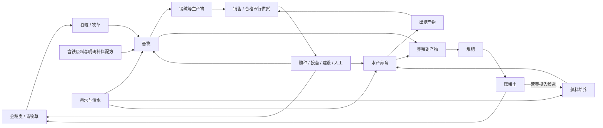

# Phase 7 — Demo V2养殖与资源循环

> 日期：2026-10-11。状态：**阶段范围已确认，投入产出与成本初值待补；尚未开始代码实施。**
> 用户已确认：钢绵羊＋滤藻鲤，仅购买幼体，不做繁殖/死亡/疾病/寿命；圈舍和水场2×2、同种最多4只且幼体计数；设施使用动物/基础食物/特殊食物三个配置栏位。地图下方新增20×8水库，V2基础地图20×22；付费扩张后置；存档无需兼容或迁移旧版本。
> 基线：[总规划](master-plan.md)、[Demo V1](demo-v1-plan.md)、[V1资源表](demo-v1-resources.md)、[Phase 6.5关闭记录](phase-06.5-UI美化与交互完善.md)。长期参考：[生产经营纲要](design-outline.md)、[物种候选库](production-system.md)、[经营机制补充](economy-systems.md)。
> 本文是产品V2的Phase文档；候选库的“v2”是资料修订号，不代表其中43种生物全部进入本阶段。范围决议见§8；标为建议的实现细节和数值仍需在资源关系表批次验证，不视为已完成。

## 1. 阶段目标和边界

V1已完成种植、天然资源点、加工、五行供货和普通雇工；Phase 6.5已完成明亮界面与基础交互。V2在此基础上接入畜牧、水产，让植物产物成为饲料，让养殖副产物返回种植和加工，并继续通过销售、供货获得元石。

本阶段的重点是**生产方式的差异与资源回流**。畜牧表现为养育、维持、周期采集；水产表现为水体经营、养育和出塘。养殖独立管理生命周期，不把动物塞进作物阶段图或现有加工批次里。

### 已确认的新决定

- 首批畜牧、水产各至少一条完整路线，与种植、加工、交易及供货相连。
- 缺食物或水只暂停对应生长和生产；不清空已积累进度，补齐后恢复。
- 采用钢绵羊＋滤藻鲤，配套青牧草和藻料培养；不同时加入备选物种。
- 只允许购买幼体，不加入繁殖、死亡、疾病和寿命。繁殖待寿命等机制设计后另排，不在V2后半补做。
- 新增圈舍与池塘（水场），各占2×2；每设施同种最多4只，幼体与成体共同计入容量。
- 点击设施后配置三个栏位：养殖动物、基础食物、特殊食物。食谱持续保留，维护由玩家手动或雇工整体执行，从共享仓库扣料。
- 基础食物负责维持与正常成长，特殊食物用于成体产出资源。本阶段不模拟饿死，“维持”体现为缺料暂停、补齐恢复。
- 在当前20×14陆地区域下方接入20×8水库，基础地图改为20×22。水场只能建在水库上；水产先做一个水体状态指标。
- 货币购买地图扩张只保留设计，推迟排期；开发阶段不要求兼容旧存档，不实现迁移。

### 沿用的经营基线

- 元石、五行材料属性与食材资格分离，不采用相生相克；蛊虫本体、战斗和饱食度留上游。
- 俯视点击，无玩家人物、雇工人物或搬运寻路；共享计数库存，资源直接进出仓库。
- 每天24AP、每时节15天；手动成功操作消耗AP，雇工按成功工作量收费。
- 日结束自动保存、三个槽、失败后阻断与原样重试；首次45天回顾，之后可以继续经营。
- 固定市场价格；订单按必要数量交付、只结算一次；rank1～5和静态供养值继续作为外部供货契约。
- 2560×1440主规格、明亮柔和UI、小图标与悬停说明，兼容窗口和独立UI缩放。

### 当前实施范围

| 内容 | 范围及详细设计状态 |
|---|---|
| 畜牧 | 钢绵羊、2×2圈舍，跑通幼体购入、育成、基础/特殊食物与周期采集 |
| 水产 | 滤藻鲤、2×2水场，建在新增水库上，跑通投苗、养育和出塘 |
| 支撑生产 | 一种饲料作物、一条藻料培养路线及必要矿物补料；具体名单见§2 |
| 回收 | 新增粪肥/鱼粪对应的堆肥变体，产出已有腐殖土 |
| 生命周期 | 幼体、成体、缺料暂停、采集/出塘；幼体仅采购，不做繁殖、死亡或寿命 |
| 人力 | 复用普通雇工，新增养殖工作的偏好与按设施指派 |
| 地图 | 20×22基础地图：上方20×14陆地＋下方20×8水库；付费扩张后置 |
| 存档 | 延续三槽与日自动保存；不要求旧版本兼容，不实现存档迁移或导入 |
| 美术 | 首先用可辨识示意图跑通流程；正式动物、圈舍和池塘图另列美术批次 |

繁殖、寿命、疾病、死亡、付费地图扩张、榨油、集热、岩石生物产业、多物种混养、动态气候、温度/溶氧/盐度模拟、物流容量、腐败、品质、遗传、特殊单位和战斗均不纳入首批。凡后续加入，需补充资源去向、成本与验收任务。

## 2. 首批生产路线

以下首批名单已由用户确认；具体食物兼容表、配方、周期和价格尚待资源关系表定稿，不把完整候选库转成实施清单。

| 定位 | 首批内容 | 必要投入 | 产物与回流 | 选择理由 |
|---|---|---|---|---|
| 畜牧 | 钢绵羊 | 草料/谷粒、清水；钢绒另需对应含铁补料 | 钢绒→销售/金供货；粪肥→堆肥→腐殖土→种植 | 同时验证周期采集和特殊原料限制 |
| 水产 | 滤藻鲤 | 基础/特殊食物及可用水体；藻料具体用途由食谱表明确 | 出塘鱼肉→销售/木供货；鱼粪→堆肥→腐殖土 | 验证水体经营和消耗成体的收获方式 |
| 饲料作物 | 青牧草 | 草籽及已有种植养护投入 | 牧草→畜牧，余料→堆肥/销售 | 农业承担持续饲料需求 |
| 水产基础培养 | 藻料培养设施 | 清水、明确的营养投入、固定光照与时间 | 藻料→水产 | 藻类属于水产基础培养，不新增第五种作物行为类别 |

堆肥鼠、净泥鳅等保留在长期候选库，未纳入首批。钢绵羊的补料是否经独立配方制备、藻料营养投入是否复用腐殖土，须在资源表中明确；不能把普通岩石默认当含铁材料。每种动物都要有可得的基础食物与特殊食物选项，不允许物种入库后其中一个栏位没有可用资源。

这是生产关系草图，不是已冻结配方。资源表需要逐项定义实际ID、输入数量、周期、主副产物、价格、用途、供养资格与成本分摊。每项新增物品至少有消费者或销售用途；不为了列副产物而加入无人使用的材料。

动物的食性由具体饲料清单/配方决定，不能套用“同五行才能喂养”的蛊虫规则。动物可吃的材料也不自动成为蛊虫食材。

## 3. 先处理玩家主动操作入口

本轮用户指出玩家主动消耗AP的入口不清楚。当前代码事实是：底部工具栏框选只创建雇工待办；手动农务在地格侧栏下方的图标行，成功一次扣1AP。V1资源采集、建设、加工启动/领取及拆除也可主动消耗AP。V0的高级3×3工具并未因此自动出现在V1。

### 已接受的操作方向

- 工具栏明确区分“手动操作”和“委托雇工”两种执行方式，当前方式常驻可见；图标保持小尺寸，执行方式与成本使用文字。
- 手动模式选择动作后点击目标立即执行，预览显示AP、材料和失败原因；初批按单目标实现，不把雇工框选变成免费手动批量操作。
- 委托模式继续框选任务、调整优先级、设置负责区域；说明“日结执行，成功收费，不消耗玩家AP”。
- 侧栏中的当前主动作前移到状态附近；完整种植资料仍可滚动查看。点一次成熟采收不需要反复确认，清理仍确认。
- 资源点、圈舍和池塘的手动操作与雇工指派分开显示，玩家能看出“立即执行”和“交给谁做”。
- 保留连续工具、右键查看、Esc层级、模态/输入阻断和存档失败保护。

同一种行为最终调用同一模型校验；只读预览不得扣AP、扣材料、创建任务或过日。手动失败零改动；委托只新增待办，不立即扣工资。手动与雇工均不能重复采同一株、收同一批或重复投喂同一日。

手动批量工具是否在V2接入、是否沿用V0的购买升级与成功AP折半规则，是独立待确认项，不默认为新增免费能力。

## 4. 养殖模型与结算建议

### 4.1 占地与在养记录

圈舍和池塘（水场）均为2×2占地设施。圈舍建在有效陆地，水场的全部四格必须在水库内；禁止越界、跨岸、覆盖植物、资源点或其他设施。

新增水库接在原陆地下面，零起始坐标区域为`[0,14,20,8]`，即y=14..21；整个V2基础地图为20×22，原陆地与资源点布局保留。V1现有土地/设施校验默认要求可耕地，不能直接用于水场：需把“可开垦”和“某类设施可建”分开校验，禁止通过将水域标为可耕来绕过限制。相机全图、边界、框选、地图数据和快照校验均按新尺寸处理。

每设施只养一种动物，容量4只，幼体与成体均计入；成长不会释放空位，也不会另生成一只成体。空位不足时整次购入失败，不扣款、不部分塞入。水库作为本版基础地图的一部分，不通过本阶段未实现的付费扩张购买。

小规模记录每个个体的唯一ID、物种、所属设施、幼体/成体状态、成长进度和生产进度；面板按设施汇总展示，不模拟移动实体。生物不是可随意增减的普通材料堆叠，活体记录与可堆叠产物分开校验。

买入幼体须同时检查元石、设施类型、已选物种和剩余容量；失败不扣款、不生成个体。出塘或处置必须更新同一份个体记录，禁止既在设施中存活又计入售出/收获。首批建议不开放自由转移；非空设施不能直接拆除或直接切换物种。不做繁殖计划、繁殖按钮和免费幼体生成。

### 4.2 三栏配置与整体维护

点击设施后的三个配置栏位固定为：

1. **养殖动物**：选择该设施可养的物种，显示在养数量/4、幼体/成体和购买幼体数量；购入操作另显示完整总价。
2. **基础食物**：选择该物种可用的基础食谱，维持并支持幼体正常成长；显示每次整体维护所需材料与持有数量。
3. **特殊食物**：选择成体生产所需的特殊食谱，显示投入、周期与主副产物；幼体不提前消耗成体生产料。

状态、成长进度、水体指标以及维护/采集按钮位于这三个栏位旁或下方，不增加第四个养殖配置栏位。食谱选择属于持续计划，仅改变配置，不购买、不扣料、不扣AP、不推进成长；无效食谱拒绝，物种切换时校验兼容性，不能沿用不适配的旧食谱。

基础料与特殊料分别满足不同需求。基础料不足时暂停对应养育；仅特殊料不足时保留基础维持和幼体成长，成体对应资源生产暂停。主副产物的条件逐项写入生产表，不能以“普通基础食物已喂”跳过特殊原料要求。

整体维护由玩家手动或指派雇工执行；仅选择食谱不会执行维护。每次显示本设施内适用个体的完整需求，基础维持按全部在养个体计算，特殊生产料按适用成体计算；避免四格设施变成四份任务，或对幼体扣四份成体生产料。基础维护与特殊生产服务分别记录完成状态，缺料的分支失败零改动，不能扣完基础料后再把整次操作显示为完全失败。

### 4.3 基础维持与特殊生产

- 基础食物与必要水条件支持正常成长与维持；成体资源生产同时检查对应特殊食物。缺少时暂停相应分支，补齐后从原进度继续。
- 特殊产物必须有对应特殊原料。钢绵羊没有含铁补料时可以维持与成长，但不能凭空产出钢绒。
- 每项维持动作按设施内适用个体数计算完整投入；显示持有/需要与服务对象。投入、当日已完成标记与有效期共同保存，不能反复喂养同一天获得多次成长。
- 手动投喂建议每座设施一次成功工作扣1AP；从共享仓库取料，不引入携带、运输或额外仓储容量。投喂批量、补水频率、特殊补料的消耗时点在资源表批次定稿。
- 已满成长/生产进度不会因多点按钮额外增加产量；零在养对象不构成成功工作，不扣AP或工资。

首版水产已确认只配置一个简化水体状态指标，建议按每座水场记录“水体可用度”；过低暂停养育，通过整体维护恢复。水库提供可建水域，不因此无代价生成可交易清水或替代泉水点。用量、消耗频率和维护配方待资源表定稿；不每天抽干并重灌整个水库，不引入温度、溶氧、盐度和多个同时衰减的指标。

### 4.4 采集与出塘

- 钢绵羊成体保留，达到周期后剪毛；收取一次重置相应生产进度，不能同时拿未到期下一轮产物。
- 鱼肉出塘会移除对应成体；出塘后该个体不能继续生产或被再次出售为活体。
- 粪肥/鱼粪与基础维持、周期生产的关联必须写入配方。没有有效投入的暂停日不免费生成副产物。
- 待收数量、产物来源与收取记录需持久化；等待玩家收取不等于每日再次生成同一份产物。

### 4.5 繁殖与寿命后置

用户明确本阶段不做繁殖，因为寿命尚未设计。幼体只能采购，正常成长为原个体的成体；不加入亲本、卵、繁殖进度、自动增殖或衰老/死亡逻辑。数据配置留出将来扩展的职责边界即可，不要求提前实现无用途字段和隐藏按钮。

### 4.6 日结顺序与保存

现有V1顺序为雇工工作→作物与环境→资源点额度刷新→加工完成→订单推进→日报/回顾→自动保存。V2须用统一调度扩展，不能让每个面板各自推进一天。

建议先让雇工完成当天投喂/维护，再结算养殖成长、周期与副产物；培养/加工产物完成后进入待收，领取前不能当成共享库存。明确新购、刚成年以及当天已手动服务对象的首次生效日，避免同日多算。刚成年不得在没有成体特殊投入的当天免费产出一轮资源。

日结产生的库存、元石、个体、设施、三栏配置、维护状态、水体、雇工费用、订单和统计作为一份完整快照保存。写失败时阻断后续操作；重试只保存原样结果，不重新喂养、产出或收费。打开面板、重载、现实等待和UI缩放不推进养殖。

用户允许开发阶段不兼容旧存档，无需迁移。本阶段不要求V0/V1快照转换、向旧schema反写或旧档导入；三槽与覆盖确认仍保留。不支持的档案明确提示重新开档，不静默解释为新版数据或自动覆盖。V2存档目录及版本标识在实现批次确定。

## 5. 人工、经济与统计接入

### 普通雇工

建议首批养殖工作为投喂、必要水体维护、剪毛/产物收取和出塘；是否合并投喂与补水由日常工作量决定。设施按ID独立指派，沿用个人偏好、优先级、日预算、暂停和成功工作上限。

同一设施的多格占地不能生成多份同类任务。工作在日结执行；缺料、缺钱、状态不符或已完成的任务跳过，失败不收费、不自动采购。建造拆除继续手动；不添加繁殖工作类型。

### 经济与供货

- 新资源沿用五行、独立供养资格、固定价格与静态供养值。至少验证一种养殖产物能加入对应订单，不能只在仓库累积。
- 养殖单位标准成本包含饲料、水、特殊原料、标准工作量与时间；主副产物分摊整批成本，不能每个产物各背一次全成本。
- 生物购入和设施建设作为一次性发展支出记录，首版建议不在每轮产物成本中重复扣整笔购入价；该成本口径须在资源表明确。
- 回流图可以有循环，基准成本图必须可求值；腐殖土继续有明确基准来源，不能由“喂养→粪肥→饲料”互相引用递归定义价格。
- 幼体开放采购，食物和补料是否开放采购按物品明确配置；采购再出售/供货不得套利，也不能在购入、收获或退款时重复生成价值。
- 首批不因新增材料自动提高V1营业收入开放rank的门槛或改变全部旧售价；需要调平衡时单独记录依据。

### 报告与回顾

最近15日报增加养殖投放/育成、维持、暂停原因、剪毛/出塘和副产物条目，仍采用分条报告。时节小结与首次45天回顾增加对应数量、基础/特殊食物及水投入、生物购入支出和期末幼体/成体数量；不把进料、成熟和收取重复算作三份出售收入。

库存、在养个体和未收产物分开显示。回顾仍以实际元石收支为准，不把剩余生物和材料估值冒充现金利润；首轮冻结和继续经营规则保持。

## 6. 分批实施

以下均为待办。阶段定稿后按顺序实施；代码、测试、配置/素材和文档按类型分批提交。

| 批次 | 工作 | 完成条件 |
|---|---|---|
| P7.a 操作与配数 | 修正手动AP入口；按已确认范围补资源总表、食谱、20×22地图布局和存档方案。设计稿：[phase-07a-操作入口与资源配数](phase-07a-操作入口与资源配数.md)（待确认） | 玩家能辨认立即执行/委托；规则及投入产出可对照，无循环前置 |
| P7.b 养殖基础与水库 | 下接20×8水库；独立养殖状态、2×2圈舍/水场、三栏配置、容量4、幼体购入/投苗、成长、缺料恢复、持久化 | 水场仅水域可建，幼体占容量，两类设施可运行；失败零改动、读档不重复结算 |
| P7.c 两条生产路线 | 饲料/藻料、特殊原料限制、周期采集/出塘、副产物堆肥回流 | 从正式新档启动两条路线，至少一次回流用于下一轮种植/培养 |
| P7.d 普通人力 | 整体维护、周期采集/出塘、偏好与设施指派 | 手动与雇工不重复服务，失败不收费，预算和任务数量正确 |
| P7.e 经营界面与记录 | 圈/池详情、缺料/缺水提示、订单、日条目与45天回顾、可跳过说明 | 鼠标能完成全流程，信息与模型一致，无输入穿透 |
| P7.f 试玩与交付 | 45天非注入经营、回归、截图、Windows V2包与操作说明 | 两条养殖、供货、回流、再投资均通过；存档版本与入口说明准确，不要求旧档迁移 |

推荐V2开发期使用独立入口，默认`play.bat`/F5继续运行已验收V1；V2收尾是否切换默认入口再确认。复用土地、时钟、库存、经济与UI底座，养殖作为独立状态模块接入；无需为了新版本复制全部V1模型和整套界面。

## 7. 验收清单

- [ ] 正式新游戏可以在没有开发注入材料的情况下启动畜牧和水产两条路线。
- [ ] 同一个工具的手动/委托含义、AP或工资成本清楚，玩家主动操作入口无需在长侧栏中寻找。
- [ ] 幼体成长、缺食/缺水暂停、补齐恢复和成体生产均可见，缺料不导致死亡或已积累进度丢失。
- [ ] 2×2圈舍/水场占用与容量4正确，幼体计数；20×8水库及20×22边界正确，跨岸/越界/满容量等失败零改动。
- [ ] 特殊产物消耗对应特殊原料；副产物可以实际回到堆肥与农业，暂停日不凭空产料。
- [ ] 周期采集与出塘差异正确，同一个体/产物/投喂工作不能重复结算。
- [ ] 三栏配置可用，选择配置不扣料/扣AP/推进时间，食谱持久化；仅采购生成幼体，幼体成长不增加个体数，不存在繁殖入口。
- [ ] 手动与雇工共享校验；成功才收费，失败不收费、不自动采购，不消耗玩家AP执行雇工工作。
- [ ] 新资源用途、成本分摊、供养资格、rank1/3/5订单和采购防套利检查通过。
- [ ] 每日自动保存与失败原样重试覆盖动物、三栏配置、维护、水场、产物和费用；不支持的旧档明确提示重新开档。
- [ ] 首次45天包含养殖收入、投入、期末个体与回流记录，之后继续经营不改写首轮回顾。
- [ ] V1/V0及历史场景按受影响范围回归；新版与旧版入口明确，发行包实际运行通过。
- [ ] 主规格及兼容窗口/三档UI缩放截图可读；圈舍、池塘、手动/委托和阻塞原因可辨识。

具体测试命令、数据烘焙入口、快照版本和发行文件名在实现批次建立后回写，不在草案中把不存在的脚本列为已可用入口。场景图沿用后续美术的机位、光照、拼接与比例审核要求，示意图验收不代表完整正式美术交付。

## 8. 范围决议与下一批设计

| 项目 | 已确认决定 |
|---|---|
| 首批物种 | 钢绵羊＋滤藻鲤，配青牧草与藻料培养，各一条路线 |
| 生命周期 | 仅采购幼体；繁殖等待寿命等设计，当前不做死亡/疾病/寿命 |
| 设施 | 圈舍和池塘（水场）均2×2；每设施同种最多4只，幼体也计数 |
| 配置 | 动物、基础食物、特殊食物三个栏位；基础料支持成长，特殊料支持成体生产 |
| 维护 | 食谱持续保留，玩家手动或雇工整体维护，直接取共享库存 |
| 水域 | 原20×14地图下接20×8水库，基础地图20×22；水场必须建在水库上；一个水体指标 |
| 主动操作 | 接受工具栏手动/委托切换；初批手动单目标，手动批量升级仍单独确定 |
| 地图扩张 | 保留货币购买扩张的方向，推迟排期，不实现本阶段购买/解锁 |
| 存档 | 开发阶段允许旧档不兼容，无需迁移；保留三槽与自动保存规则 |

付费扩张的后续设计方向为用元石解锁新增土地/水域，并统一校验可建范围、占用与存档。此次只登记方向，不增加购买入口、锁格规则、扩张价格或无用途存档字段；当前20×22是完整基础地图。

下一批资源关系表需要补齐：基础/特殊食物兼容与完整数量、购入幼体价格、养成/生产周期、圈舍/水场造价、维护工作量、水体指标与恢复配方、主副产物条件及静态供养值。初始60元石和原基础种子暂沿用建议，验证首笔投入能启动后给出初值；付费地图扩张不参与这次验证。

范围已确认的内容不重复询问。实现中若数值显示现有泉水额度、初始现金或生产原料无法支撑四只容量下的基本养育，先给出具体瓶颈与调整提案，不以免费补料或删去特殊投入掩盖问题。

## 9. 执行记录

### 2026-10-11：Phase 7 / V2起草

- 用户要求先起草Phase文档；本批只整理设计，养殖代码尚未实施。
- 已阅读V1/Phase 6.5关闭记录、资源关系表、生产纲要、物种候选库及机制补充，并核对现有手动AP入口、土地占用、日结与schema 6快照。
- 用户确认畜牧和水产各一条路线；缺食物或水暂停并可恢复；不引入死亡、疾病和寿命。上述决定替代长期候选中对应的复杂生命周期设想。
- 建立路线候选、P7.a～f、验收清单和六项待确认问题；同步总规划及交接入口。所有实现与验收仍未勾选，当前默认入口及代码未改变。

### 2026-10-11：范围问答与设施/水库确认

- 用户接受钢绵羊＋滤藻鲤和手动/委托方向；明确只采购幼体，繁殖因寿命未设计而后置。
- 用户确定2×2圈舍/水场、动物/基础食物/特殊食物三栏、整体维护和单水体指标；水场建设必须位于水库。
- 补充确认水库接在现有地图下面，基础20×22、水域20×8；每设施同种最多4只且幼体计数；维护由玩家或雇工执行，配置食谱本身不执行维护。
- 货币购买地图扩张保留设计但推迟排期；开发阶段无需旧档兼容或迁移。已移除繁殖实现/验收任务，更新P7.a～f；代码尚未实施，下一批补资源关系与配数。

### 2026-10-11：P7.a 设计稿起草

- 按用户要求先出设计稿再实施。已核对V1资源表/订单与成本审计机制、物种候选库、schema 6快照、工具栏与侧栏现状、farm_01地图与烘焙管线。
- 产出[phase-07a设计稿](phase-07a-操作入口与资源配数.md)：手动/委托工具栏方案、7新物品＋2活体、青牧草、圈舍/水场/藻类培养槽、4新配方、两物种完整配数（成长/周期/食谱/水体指标）、farm_02 20×22布局、schema 7存档方案、成本模型与防套利、60元石启动演算。
- 稿内列出8项待确认决策（补料形态、藻料营养源、鲤鱼特殊食物、粪肥堆肥产出、补料消耗时点、默认模式、幼体价格、V2命名）；确认后按稿内§9任务清单实施，代码仍未动。
