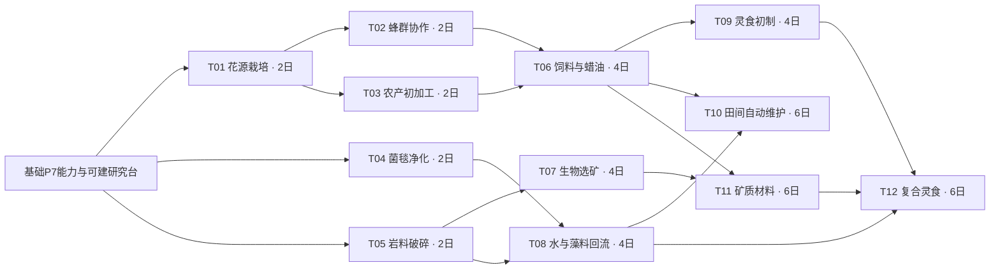
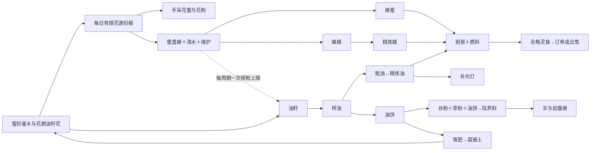
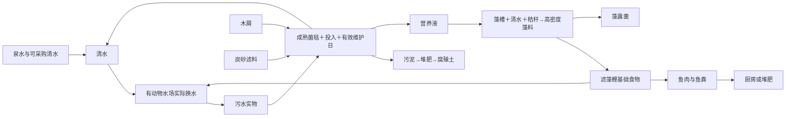
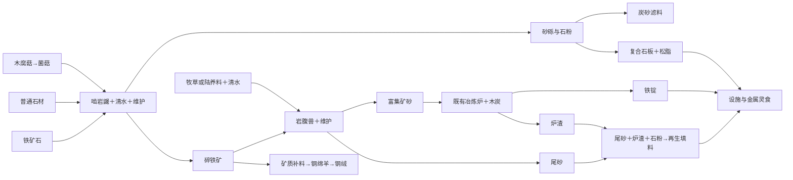

# Phase 8 — 研究与生产关系

> 日期：2026-10-13。状态：**研究与生产网络已实装，P8本地测试阶段已完成。** [总纲](phase-08-生态产业网络与工艺研究.md)确定范围，[资源表](phase-08-资源与工艺表.md)确定物料与配数。12项研究在A/B两条正常经营路线的第90日前均完成，完整工艺消费补验至120日；Windows独立包后置。

## 1. 研究语义与初始能力

P7已掌握的种植、木材加工、炭化、堆肥、普通冶炼、牧渔和藻槽默认已知。研究台本身可直接建造，不需要先研究研究台。基础水场实际换水生成污水是P8基础行为，不受T04锁定，保证T04样本可获得。

研究解锁工艺/购买资格/设施，不立即建造设施，不免费发种子、幼体或产物。解锁不等于现有设施自动切配方；每个实例仍由玩家配置。生物工作条件与材料投入独立于是否掌握研究。

项目全农场只完成一次。同项目只允许一台在研，前置满足且支付成功才建立实例；暂停不丢进度。每台每天一次有效研究工作，手动1AP或雇工一次工作/1元石。不靠挂满研究台无工作自动推进，不允许当天第二次推进，存读档保留当天工作记录。

详细状态机见[P8.c](phase-08c-研究系统与依赖导航.md)：启动初值0AP，只一次支付样本/元石；成功工作建立当天唯一收据，日结据此推进1有效日，完成自动解锁。不能点击和日结各加一次。忙碌/暂停台不支持取消退款、转移或拆除，完成后的空台可拆而知识保留。

## 2. 十二研究项目

表中前置是“全部满足”，`—`表示只需基础能力。时间为有效研究日，不是启动后经过的日历日。资源ID与R/V编号见资源表。

| 编号/项目ID | 层 | 项目 | 前置 | 样本 | 元石 | 有效日 | 解锁 |
|---|---|---|---|---|---|---|---|
| T01 `flower_cultivation` | 1 | 花源栽培 | — | `grain×2, humus×1` | 4 | 2 | 蜜铃苗/油籽花种子购买、两植物种植与供花 |
| T02 `beekeeping` | 1 | 蜂群协作 | T01 | `nectar×2, pollen×1` | 6 | 2 | 蜂箱、蜜盏蜂购买、共享花源与授粉 |
| T03 `farm_preparation` | 1 | 农产初加工 | T01 | `oilseed×2, straw×2` | 6 | 2 | 农产加工台、R01/R02/R03、V01 |
| T04 `biofiltration` | 1 | 菌毯净化 | — | `wastewater×2, mushroom×1` | 4 | 2 | 净水菌床/培养单位、R10、V02 |
| T05 `rock_handling` | 1 | 岩料破碎 | — | `mushroom×1, raw_stone×3` | 6 | 2 | 岩兽工作场、啮岩鼹购买、R13/R14 |
| T06 `advanced_feed_oil_wax` | 2 | 饲料与蜡油精制 | T02/T03 | `crude_oil×1, beeswax×1, grain_meal×1` | 8 | 4 | R04/R05/R06/R07、V03、陆养/水养复合食谱 |
| T07 `ore_concentration` | 2 | 生物选矿 | T05 | `crushed_ore×2, gravel×1, fodder_grass×2` | 8 | 4 | 岩腹兽购买、R15 |
| T08 `water_recirculation` | 2 | 水与藻料回流 | T04/T05 | `sludge×1, gravel×1, charcoal×1` | 8 | 4 | R09/R11/R12、高密度藻基础食谱 |
| T09 `basic_spirit_cooking` | 2 | 灵食初制 | T06 | `honey×1, grain_meal×1, fish_meat×1` | 8 | 4 | 厨房、R19/R20 |
| T10 `field_maintenance` | 3 | 田间自动维护 | T06/T08 | `humus×2, clean_water×4, land_feed×1` | 12 | 6 | 田间维护站、灌溉与施肥功能 |
| T11 `mineral_materials` | 3 | 矿质材料工艺 | T06/T07 | `ore_concentrate×1, iron_ingot×1, stone_powder×1` | 12 | 6 | R08/R16/R17/R18、羊矿质食谱、补光灯 |
| T12 `composite_spirit_food` | 3 | 复合灵食 | T09/T08/T11 | `refined_oil×1, dense_algae×1, iron_ingot×1` | 12 | 6 | R21/R22/R23/R24 |

共5项第一层、4项第二层、3项第三层，合计44个有效研究日、94元石启动费；全部手动另需44AP，全部雇工另需44元石成功工作费。多台可并行**不同**项目以缩短日历时间，不减少总有效日/样本/费用。当前费用沿用已编译值，A/B两条路线已通过可负担性及样本可达检查。

T09依赖同层T06，三层表示能力深度，不强制每层项目互不依赖。T11补光灯所需复合石板可以先在旧木作台用同次解锁的R17制作，不需要先有补光灯；T12高密度藻样本通过既有藻槽普通加工模型取得，不要求补光灯或T12自身成品。现有藻槽没有光照校验，本期不新增该门槛。

### 前置图：不允许循环

## 3. 生产网：允许有损循环

下图展示路线，不省略实际成本的义务。具体份数、有效日、维护食谱和燃料以资源表为准；图中不是“一条线就免费转换”。

### 花源、油料、陆养与灵食

### 水场、净化、藻料与水养

换水2清水产生2污水，净化返回液体少于投入；循环依赖维护、培养投入和损耗，泉水不会被净化替代为无成本无限源。水体可用度只在设施状态中显示，不能直接卖成清水。

### 岩石、矿料、金属与回填

既有矿石直接冶炼保留；选矿路线节约矿料但增加育成、日粮、维护及加工时间，不以“生物可以产矿”取代投入。尾砂/炉渣作为无可回收铁的填料终点，不能接回采矿或钢绒循环。

## 4. 解锁、成本与循环的三类检查

研究图必须拓扑排序成功，每个样本有默认或祖先能力生产路径；解锁设施不得要求只有该设施能产的建材。当前新档90元石，使用正式初始物资建立样本生产，不注入免费样本掩盖锁死；历史60元石静态草案和回放证据分别保留。

生产网允许有环，但每个产出须有下游用途或明确市场出口；每批投入/食物/燃料/成功工作可追溯。水和铁按资源表单独校验，未收取不入库、源份额不复制、幼体不繁殖、尾矿不再提铁。

成本计算图另选**固定标准来源**且必须无环，不遍历全部回收路线自动求最低价。例如清水成本使用泉水而非净化、腐殖土使用既有秸秆堆肥；参考成本稳定，实际运行现金/材料流另记。这允许循环经营，不造成供养值随当前路线不停变化。

## 5. 玩家如何理解网络

当前研究页按三层卡片显示元石/样本、来源、有效日、前置、解锁数量和进行中研究台；锁定项目仍可读获取路线。点击空研究台选择项目，启动、手动研究、暂停和负责人配置在该台详情执行；新手手册说明A/B实际操作路线。

相应设施详情提供当前批次/食谱、产物、目标、保留量、缺料和手动动作；雇工页展示多设施绑定、工作量/积压及定位，养殖总览继续复用。花源覆盖和矿物投入说明不生成新背包栏。模块/五行研究筛选、统一物品生产消费资料和全产业集中总览属于后续界面扩展，用户已接受本阶段现有页面，不将这些扩展追加为关闭条件。

经营验收先验证三组生态实际流量，第90日核对全部12研究，至120日补齐27条新工艺/变体的收取与所有产物后续合法消费；单看解锁数量或截图不算产业完成。第45天回顾保持历史快照，之后可查看当前经营账，不新增强制结束按钮。

2026-10-13：12研究及依赖生产路线已完成本地验收，现有页面由用户接受；默认P8、最终回归通过，Windows包后置。具体证据和未执行范围见[P8.h](phase-08h-90日经营验收与交付.md)。

## 2026-10-13 扩地收尾

三批东侧陆地和东西侧水库购买已完成：新增陆地112格/380元石、水面96格/280元石，仍共用连续地图、仓库与经营时间；原坐标、研究、生产配数及供养值不变。外接32×22，schema17，旧schema16 P8档需重新开档。详见[扩地方案](phase-08h-扩地与经营余量方案.md)及[P8.h最终记录](phase-08h-90日经营验收与交付.md)。历史条目按当时版本保留。
